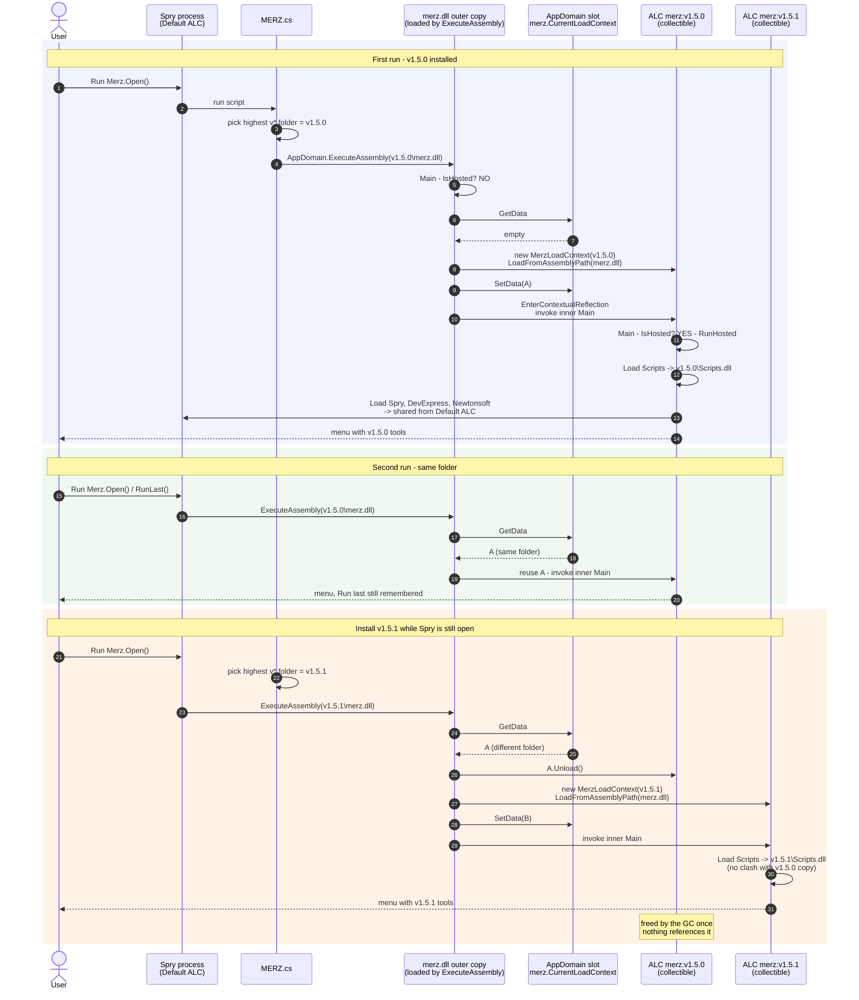
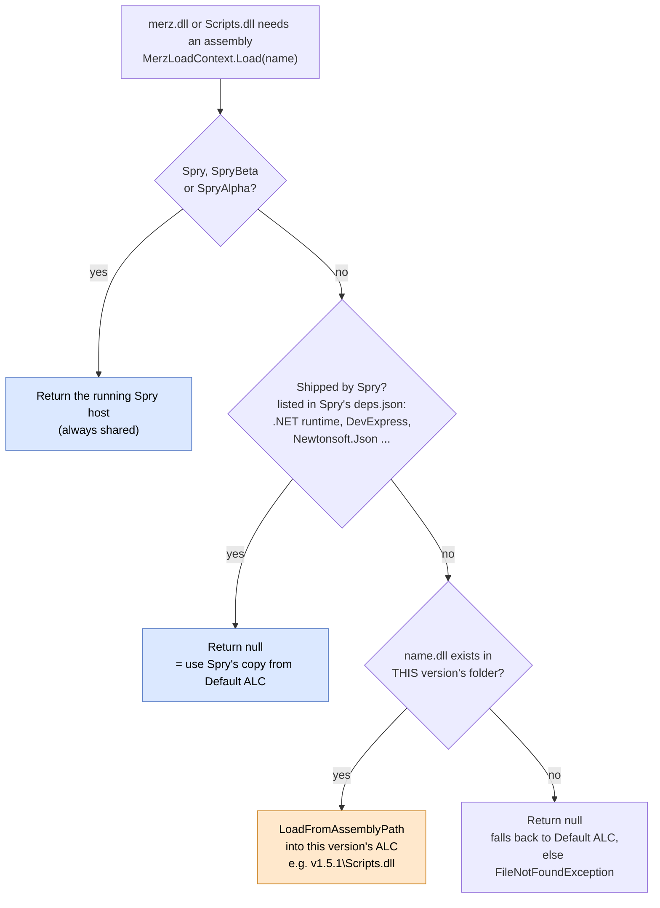
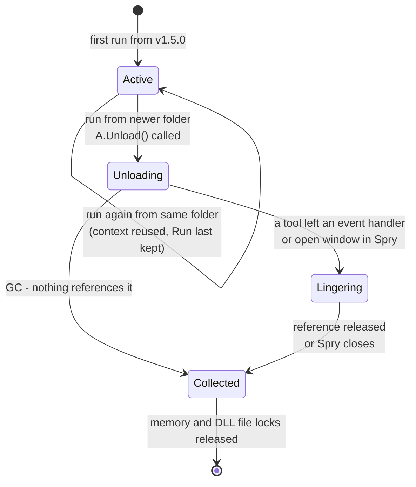

# Building merz for .NET 8 Spry

Spry moved from .NET Framework 4.7.2/4.8 to a **self-contained .NET 8** application (Spry 27.x).
merz runs *inside* Spry's process, so merz and `Scripts.dll` have to be built for the same runtime.
This guide covers building, packaging and installing merz for .NET 8 Spry.

> This describes the **net8-only build** currently in this checkout (`merz.csproj` targets
> `net8.0-windows`). If PR #55 (the multi-target / facade approach) is merged instead, see
> [If PR #55 is merged instead](#if-pr-55-is-merged-instead) at the end.

---

## 1. What changed and why

| | .NET Framework Spry (25.x) | .NET 8 Spry (27.x) |
|---|---|---|
| Spry's code lives in | `Spry.exe` (managed) | `Spry.dll` — `Spry.exe` is only a ~200 KB native launcher |
| Install folder | wherever Spry was installed | `%LOCALAPPDATA%\Spry\current` (Alpha: `%LOCALAPPDATA%\SpryProto\<version>`, `SpryAlpha.dll`) |
| merz output | `merz.exe` + `merz.exe.config` | `merz.dll` (+ `merz.deps.json`, `merz.runtimeconfig.json`) — no `merz.exe` |
| merz target | `net48` | `net8.0-windows` (WinForms) |

The original error

```
[ERROR]: Could not find a Spry installation, is this being run through Spry?
```

came from `BringInSpry()` in `merz_src/Program.cs` checking that the entry assembly's path ends in
`Spry.exe`. On .NET 8 the entry assembly is `Spry.dll`, so the check always failed. It now looks for
the loaded assembly named `Spry` / `SpryBeta` / `SpryAlpha` instead.

---

## 2. Prerequisites

| Requirement | Notes |
|---|---|
| Windows x64 | |
| .NET SDK **8.0 or newer** | Tested with SDK 10.0.302. Check with `dotnet --list-sdks`. |
| **.NET 8 Spry installed** | Default location `%LOCALAPPDATA%\Spry\current\Spry.dll`. merz compiles against this file. |
| `pm-spry-tools` submodule checked out | `git submodule update --init --recursive` |
| Inno Setup 6 (only for the installer) | Provides `ISCC.exe`. Not needed just to build. |

You **no longer** need the old `merz_src/Spry.exe` or the `25.5.2083.7z` archive for this build.

---

## 3. Project setup (already done in this checkout)

These are the changes that make the build work. They're listed here so you can re-apply them or
review them.

### `merz_src/merz.csproj`
- `TargetFramework` = `net8.0-windows`, `UseWindowsForms` = `true`, `PlatformTarget` = `x64`
- `UseAppHost` = `false`, so only `merz.dll` is produced (Spry loads it in-process).
- References `$(SpryDir)\Spry.dll` with `Private=False`. `SpryDir` defaults to
  `$(LOCALAPPDATA)\Spry\current`.
- `System.Drawing.Common` **10.0.0** with `ExcludeAssets="runtime"`, because Spry 27.x is built
  against 10.0, which is newer than the 8.0 copy in the WindowsDesktop framework.
- Removed `System.Net.Http`, `System.Memory`, `System.Numerics.Vectors`, `System.Text.Json`. They are
  part of .NET 8.
- A `CheckSpryReference` target fails early with a clear message if `Spry.dll` isn't found.

### `pm-spry-tools/.config/Scripts.csproj` (submodule)
- Converted from the old-style (net48, `msbuild`) project to an **SDK-style** `net8.0-windows` project.
- Same `SpryDir` / `Spry.dll` reference and `System.Drawing.Common` 10.0 package as merz.
- `LangVersion` pinned to **12.0**. Do not use `latest`: C# 14 binds `array.Reverse()` to the
  in-place `Span<T>.Reverse()` (returns `void`) and breaks existing LINQ code.
- `EnableDefaultCompileItems=false`. Sources come from `..\**\*.cs`, excluding `.config`,
  `.github`, `bin` and `obj`.

### Source fixes
- `pm-spry-tools/Data Table/Table Level Collapse/UserInputs.cs`: added
  `using Range = PrecisionMining.Spry.Data.Range;`, because `System.Range` exists on .NET 8.
- `merz_src/Program.cs`:
  - Spry detection by assembly name (see section 1).
  - `Main` immediately re-runs merz inside its own load context (see below).
  - Tool discovery scans the `Scripts.dll` merz is bound to, instead of loading it a second time.
  - New `check` argument: lists the discovered tools without opening the menu.
- `merz_src/MerzLoadContext.cs` (new): loads each install folder (`merz.dll`, `Scripts.dll`, …) into
  its own **collectible `AssemblyLoadContext`**. Spry, the .NET runtime and every DLL Spry ships are
  shared from Spry's default context. See [section 6a](#6a-installing-a-new-version-while-spry-is-open).
- `merz_src/MERZ.cs` (the Spry-side launcher script): looks for `merz.dll` first, then falls back
  to `merz.exe`.

---

## 4. Build

### Option A: build script (recommended)

From the repo root:

```powershell
.\build-local.ps1                                  # Debug, Spry from %LOCALAPPDATA%\Spry\current
.\build-local.ps1 -Configuration Release
.\build-local.ps1 -SpryDir "D:\Tools\Spry\current" # Spry installed somewhere else
```

The script:
1. Checks that `<SpryDir>\Spry.dll` exists.
2. Runs `dotnet build merz_src/merz.csproj -p:SpryDir=<SpryDir>`. This also builds `Scripts.csproj`.
3. Copies `pm-spry-tools/merz-config.json` into the output if it exists. Without it, all tools are
   enabled.

### Option B: plain `dotnet build`

```powershell
dotnet build merz_src/merz.csproj -c Release
dotnet build merz_src/merz.csproj -c Release -p:SpryDir="C:\path\to\folder\with\Spry.dll"
```

### Output

`merz_src/bin/<Configuration>/net8.0-windows/`:

| File | Needed at runtime |
|---|---|
| `merz.dll` | yes, the program Spry loads |
| `Scripts.dll` | yes, all the tools |
| `merz.deps.json`, `merz.runtimeconfig.json` | shipped, harmless |
| `Newtonsoft.Json.dll` | shipped; Spry's own copy is normally used |
| `merz-config.json` | optional, tool filter |
| `*.pdb` | optional, debugging only |

Expect a large number of warnings, mostly from the pm-spry-tools sources plus a few `MSB3277`
version-conflict warnings. They don't block the build. A successful build ends with `0 Error(s)`.

---

## 5. Package (Inno Setup)

`Package.iss` is set up for the .NET 8 output:

- Takes files from `#define BuildDir "merz_src/bin/Debug/net8.0-windows"`. **Change `Debug` to
  `Release`** if you built Release.
- Installs `merz.dll`, `merz.deps.json`, `merz.runtimeconfig.json`, `Scripts.dll`,
  `Newtonsoft.Json.dll`, `merz-config.json` (if present), `MERZ.cs`, docs, bundled files, the runtime
  viewer and the licence.
- `[InstallDelete]` removes old .NET Framework leftovers (`merz.exe`, `merz.exe.config`,
  `System.Memory.dll`, `System.Buffers.dll`, `System.Numerics.Vectors.dll`).
- Bump `#define AppVersion` for each release.

```powershell
& "C:\Program Files (x86)\Inno Setup 6\ISCC.exe" Package.iss
```

The installer is written to `target/packaged/merz-installer.exe`.

---

## 6. Install and run

1. Run `merz-installer.exe`. It installs to `%LOCALAPPDATA%\Programs\merz\<AppVersion>` (for
   example `...\Programs\merz\v1.4.7`).
2. **Re-import `MERZ.cs` into Spry.** Replace the old project script with the one from the install
   folder or `merz_src/MERZ.cs`. The old script only looks for `merz.exe`, which no longer exists.
3. In Spry, run `Merz.Open()` (or `Merz.RunLast()`). `MERZ.cs` picks the highest `v*` folder and
   runs its `merz.dll`.

Without an installer (dev loop), copy the contents of `merz_src/bin/Debug/net8.0-windows/` into
`%LOCALAPPDATA%\Programs\merz\v<something-higher>` and run `Merz.Open()` from Spry.

### Debug output
Pass `--debug` to merz (for example, edit `Open()` in `MERZ.cs` to call `@do("--debug")`), or set
the environment variable `MERZ_DEBUG=1` before starting Spry. It prints which install folder was
loaded, the Spry assembly found and where `Scripts.dll` came from to Spry's output window.

### Checking an install without the menu
`@do("check")` (or `check --debug`) prints `merz <version> check: N tools discovered` followed by
the tool list. If N is 0, see the troubleshooting table.

## 6a. Installing a new version while Spry is open

You don't need to restart Spry after installing a new merz version.

- Every install folder (`...\Programs\merz\v1.5.0`, `v1.5.1`, …) is loaded into its **own
  collectible `AssemblyLoadContext`** (`MerzLoadContext.cs`). That context gets that folder's own
  `merz.dll` and `Scripts.dll`.
- Running merz from the **same** folder again reuses its context, so *Run last* still remembers the
  last tool.
- Running merz from a **newer** folder (`MERZ.cs` always picks the highest `v*`) unloads the previous
  version's context and loads the new one. *Run last* starts fresh after an upgrade.
- Spry itself, the .NET runtime and every DLL Spry ships (DevExpress, Newtonsoft.Json, …) are always
  shared with Spry, never loaded twice.

### Runs and upgrade without restarting Spry



### Where each DLL comes from (`MerzLoadContext.Load`)



### Life of one version's context



Spry's shared Default ALC can hold only **one** `Scripts.dll`. Each install folder gets its **own
collectible ALC**, so v1.5.0 and v1.5.1 never compete for the same name. Only Spry and the DLLs it
ships are shared. The process-wide **slot** (`AppDomain` data) is how one version's copy of merz
finds and unloads the previous version's context.

Before this, `Scripts.dll` went into Spry's default context, which can hold only one assembly per
name. After an upgrade the old `Scripts.dll` stayed loaded, the new one failed with
"Assembly with same name is already loaded", and the menu came up **empty** until Spry restarted.

Unloading is cooperative: the old version's memory is freed once nothing references it. If a tool
left something behind in Spry (for example an event handler or an open window), the old version
stays in memory until Spry restarts, but the new version still loads and runs correctly. While a
version is loaded its DLLs are locked, so uninstall old versions with Spry closed.

---

## 7. Troubleshooting

| Symptom | Cause | Fix |
|---|---|---|
| `Could not find a Spry installation, is this being run through Spry?` | Old merz build (checks for `Spry.exe`) | Rebuild with the updated `Program.cs` |
| `Could not find the merz program (merz.dll)` | Old install, or wrong folder | Install the new build into `%LOCALAPPDATA%\Programs\merz\v*` |
| `BadImageFormatException` when Spry runs merz | `MERZ.cs` is pointing at a native `merz.exe` | Re-import the new `MERZ.cs`; make sure `UseAppHost=false` |
| Build: `Spry.dll (.NET 8) not found in '...'` | Spry not at the default path | `-SpryDir` / `-p:SpryDir=...` |
| Build: `CS1705 ... System.Drawing.Common, Version=10.0.0.0 ... higher version` | Missing the 10.0 package reference | Add `System.Drawing.Common` 10.0.0 (`ExcludeAssets="runtime"`) to both projects |
| Build: `CS0023 Operator '.' cannot be applied to operand of type 'void'` on `.Reverse()` | C# 14 span overload | `LangVersion` 12.0 in `Scripts.csproj` |
| Build: `CS0104 'Range' is an ambiguous reference` | `System.Range` vs `PrecisionMining.Spry.Data.Range` | Add a `using Range = PrecisionMining.Spry.Data.Range;` alias |
| Menu opens but is **empty** (title shows the right version) | The installed merz has no `MerzLoadContext`, and an older `Scripts.dll` from an earlier run in the same Spry session blocks the new one | Install a build that includes `MerzLoadContext.cs` (it works even with the old `Scripts.dll` still loaded), or restart Spry |
| No tools listed / `Could not load Scripts.dll` | `Scripts.dll` not next to `merz.dll` | Check the install folder; run `check --debug` |
| `Could not find the merz program at '...\merz.exe'` | Spry still has the old `MERZ.cs` (only looks for `merz.exe`) | Replace `MERZ.cs` in the Spry project with the new one |
| A tool fails with `MissingMethodException` / `TypeLoadException` | That Spry API changed between 25.x and 27.x | Fix the tool's source against the new Spry API |

---

## 8. CI / release workflow (still to update)

The GitHub workflows in `pm-spry-tools/.github/workflows` (`dotnet.yml`, `release.yml`) still build
the old way. To build for .NET 8 they need:

- A .NET 8 Spry to compile against. Replace the `25.5.2083.7z` archive with one containing the
  .NET 8 `Spry.dll` and its `System.Drawing.Common.dll`, and pass `-p:SpryDir=<extracted folder>`.
- **Remove** the step that injects a `Spry.exe` `<Reference>` into `Scripts.csproj`. The SDK-style
  project already references `$(SpryDir)\Spry.dll`, so injecting would duplicate it.
- `dotnet build merz.csproj -c Release -p:SpryDir=...` instead of `--framework net48` / `msbuild`.
- Output path `bin/<Configuration>/net8.0-windows` instead of `net48`.
- Update the installer file list (in `release.yml` and `pm-spry-tools/Package.iss`) to the files
  listed in section 5. Drop `merz.exe`, `merz.exe.config` and the `System.*` DLLs.

---

## If PR #55 is merged instead

PR #55 keeps the **.NET Framework** merz and Scripts and adds a .NET 8 adapter instead of rebuilding
everything for .NET 8:

- `merz.csproj` multi-targets `net48;net8.0-windows` and still compiles against the old
  `merz_src/Spry.exe` (25.5). `Scripts.csproj` stays net48.
- On .NET 8 Spry, the net48 `merz.exe` hands off to `<install>\net8\merz.dll`. That loads itself into
  a private `AssemblyLoadContext` (`MerzLoadContext.cs`). There, the reference to "Spry 25.5" is
  answered by an in-memory facade of type forwarders to the real host assembly (`SpryFacade.cs`).
- `MERZ.cs` is unchanged, so users don't need to re-import it, and one install works on old and new
  Spry.

Build and packaging differences in that case:

- Build both targets: `dotnet build merz_src/merz.csproj -c Release` (no `--framework net48`).
  Scripts still needs the old `Spry.exe` reference, as in CI today.
- The installer must ship the net48 files **and** copy
  `bin/<Config>/net8.0-windows/merz.dll` into an **`{app}\net8\`** subfolder. The PR doesn't do this
  yet. Without it, .NET 8 Spry reports "merz .NET 8 build was not found".
- Run `merz check` against the target Spry. It resolves every Spry type and member that merz and
  Scripts use, and lists any that no longer exist in Spry 27.x.
